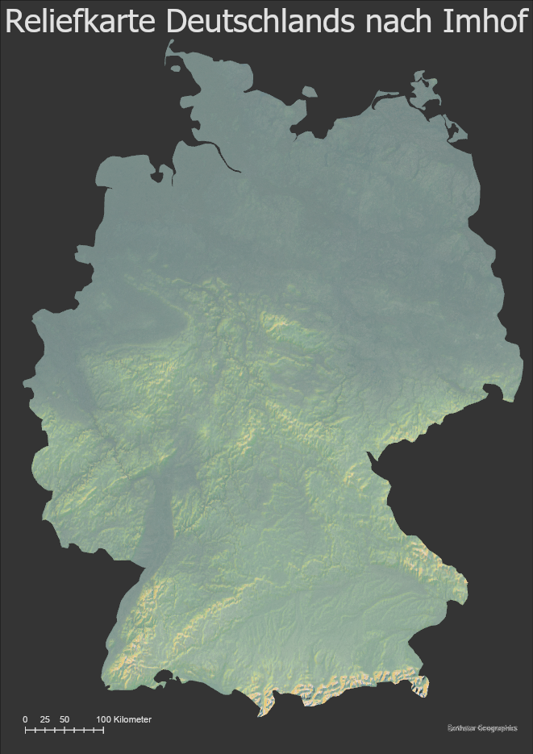
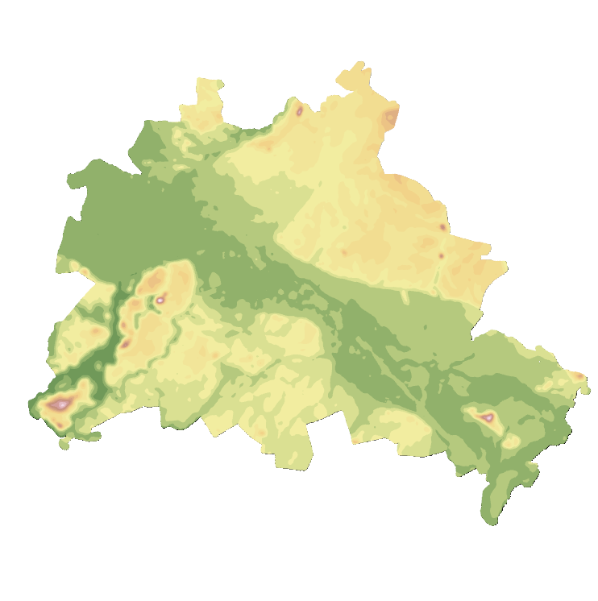

# Gelaendedarstellung
## 1. Woche (08.10.2026) - Geländedarstellung I
Erste Karte mit ArcGIS Pro. 

Gelernt:
- Höhenraster importieren (.bil)
- Einfache Farbverläufe
- Einfache Schummerung über Raster-Funktionen
- Grobes Layout
- Layer-Verschmelzungen

Probleme:
- Karte zu klein geworden

## 2. & 3. Woche (22. - 29.10.2026) - Geländedarstellung II
Zweite Karte mit ArcGis Pro im Stil von Imhof.

Gelernt:
- Der Stil von Imhof
- Symbolisierung
- Farbverläufe selbst erstellen
- Styles importieren
- Living Atlas kennengelernt und Ländergrenzen daraus importiert
- Global Background und Maske für dunklen Hintergrund aus Living Atlas
- Mit Layer-Reihenfolgen und Verschmelzungen experimentiert für eine Annäherung an Imhof's Stil
- Genaue Zoomstufen durch Maßstabsänderungen bestimmen
- Grafischer Maßstab im Layout

Probleme:
- Stil der Karte auch vom Maßstab abhängig

## 4. Woche (05.11.2026) - Geländedarstellung Reproduktion Übung
Reproduktion des Stils einer Wandkarte von Berlin-Brandenburg.

)

## 5. Woche (12.11.2026) - Höhenschichten & Tanaka

Darstellung von Höhenschichten in Berlin.

